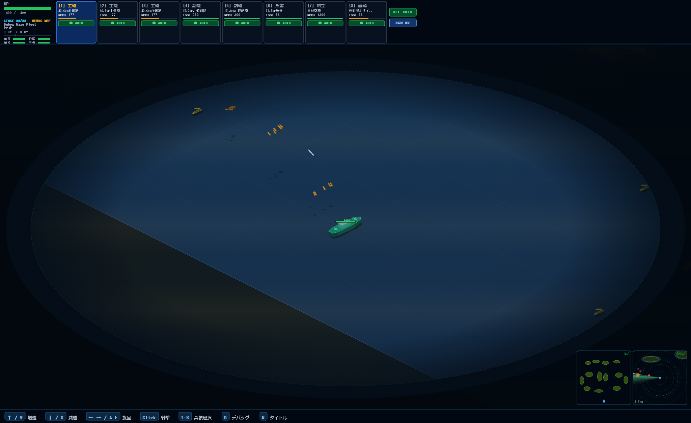

# Battleship Operation

Battleship Operation は、艦船設計・艦隊戦・リアルタイム海戦を Web ゲームとして実装していくプロトタイプです。

現在は Vite + TypeScript + Canvas で、決定論的な戦闘シミュレーション、プレイヤー艦の移動、複数兵装、敵艦 AI、HUD、WebAudio による戦闘音、ユニットテスト用の simulation harness を備えています。

## Concept

本プロジェクトは、3D 海戦アクションと艦船カスタマイズを中核にしたゲーム体験を、Web ブラウザ上で検証しながら作ることを目的にしています。

開発方針として、描画や入力よりも先に「再現できるゲームロジック」を重視します。同じ seed、同じ入力列、同じデータであれば同じ戦闘結果になるようにし、テスト・リプレイ・バランス調整をしやすい構成を目指します。

## Current Features

- Canvas による海域描画
- プレイヤー艦の移動、旋回、速度変更
- 主砲、魚雷、対空砲、ミサイルの切り替えと射撃
- 敵駆逐艦・巡洋艦の簡易 AI
- 弾道、命中、ダメージ、撃沈判定
- HUD による HP、兵装、弾薬、戦闘状況の表示
- 兵装ごとの自動射撃切り替え
- WebAudio による射撃音・命中音
- seedable random による決定論的な乱数 stream
- Vitest による simulation unit tests
- Playwright による E2E smoke tests

## Screenshots

### Play Screen
ゲームのプレイ画面では、海域がCanvasで描かれ、プレイヤー艦（青い船）が中央に表示され、周囲に敵艦（赤い船）がAIで動きます。HUDにはHP、兵装、弾薬の情報が表示され、戦闘状況をリアルタイムで確認できます。




- Node.js 18 以上
- npm

## Setup

```bash
npm install
```

## Development

```bash
npm run dev
```

Vite の dev server が起動したら、表示された URL をブラウザで開きます。

## Controls

海中探索ゲーム **ABYSS** は、開発サーバーの `/underwater.html` で遊べます。
艦船ゲームとは独立した3D潜水艇ゲームです。詳しい操作は [ABYSS の遊び方](docs/underwater-game.md) を参照してください。

| Input | Action |
| --- | --- |
| `W` / `ArrowUp` | 速度を上げる |
| `S` / `ArrowDown` | 速度を下げる |
| `A` / `ArrowLeft` | 左旋回 |
| `D` / `ArrowRight` | 右旋回 |
| `1` | 主砲を選択 |
| `2` | 魚雷を選択 |
| `3` | 対空砲を選択 |
| `4` | ミサイルを選択 |
| Click | 選択中の兵装で指定地点を攻撃 |
| HUD buttons | 兵装ごとの自動射撃を切り替え |
| `R` | 戦闘終了後にリスタート |

## Scripts

```bash
npm run dev        # 開発サーバー
npm run build      # TypeScript check + production build
npm run preview    # production build の preview
npm run typecheck  # TypeScript 型チェック
npm test           # unit tests
npm run test:e2e   # Playwright E2E tests
```

## Project Structure

```text
src/
  game/
    audio/        # WebAudio sound system
    data/         # static data and initial state
    input/        # keyboard / mouse input adapter
    rendering/
      canvas-utils.ts   # shared canvas drawing utilities (roundRect etc.)
      canvas.ts         # main canvas renderer
      ...               # other renderers
    simulation/
      types.ts          # entity types + isShip/isBuilding/... type guards
      player-commands.ts # player state mutations (toggleAutoFire, isBossStage, …)
      ai.ts             # enemy AI with behavior dispatch table
      ...               # combat, movement, weapons, etc.
    ui/
      pause-overlay.ts  # pause screen rendering (extracted from main.ts)
      hud.ts            # in-combat HUD
      ...               # other screens
  harness/
    fixtures/     # simulation fixtures
    simulation/   # headless simulation runner
tests/
  unit/           # Vitest unit tests
  e2e/            # Playwright smoke tests
docs/             # design and harness engineering docs
```

## Documentation

設計方針と検証方針は `docs/` にまとめています。

- [docs/README.md](docs/README.md)
- [docs/product-brief.md](docs/product-brief.md)
- [docs/harness-engineering.md](docs/harness-engineering.md)
- [docs/simulation-contracts.md](docs/simulation-contracts.md)
- [docs/test-strategy.md](docs/test-strategy.md)
- [docs/data-and-fixtures.md](docs/data-and-fixtures.md)
- [docs/roadmap.md](docs/roadmap.md)

## Engineering Principles

- Game logic is separated from rendering.
- Simulation advances with fixed ticks.
- Randomness is injected through seedable streams.
- Important gameplay events are recorded as event logs.
- Browser tests validate that the app can start and render.
- Balance changes should eventually be reviewed through reproducible fixtures.

### SOLID 設計方針

| 原則 | 適用箇所 |
| --- | --- |
| **SRP** — 単一責任 | `pause-overlay.ts` にポーズ UI を集約。`player-commands.ts` にプレイヤー状態操作を集約。`canvas-utils.ts` に描画ユーティリティを集約し、7 ファイルの重複定義を解消。 |
| **OCP** — 開放閉鎖 | `ai.ts` の敵 AI を `AI_BEHAVIORS` ディスパッチテーブルで管理。新しい敵艦クラスは既存コードを変更せずエントリを追加するだけで対応可能。 |
| **LSP** — リスコフ置換 | `WeaponStrategy` の継承階層は `TorpedoWeaponStrategy` が `canTargetBuilding()` を正しくオーバーライドし、契約を守った設計を維持。 |
| **ISP** — インターフェース分離 | `types.ts` に `isShip` / `isBuilding` / `isProjectile` / `isObjective` 型ガードを追加。`as ShipEntity` の unsafe キャストをガード関数で置き換え。 |
| **DIP** — 依存性逆転 | `main.ts` は具体実装を直接 new しているが、状態操作・UI 描画・AI の各責務は独立したモジュールとして分離済み。 |

## Status

This is an early playable prototype. The next major milestones are ship selection, ship design, richer mission objectives, golden replay comparison, and broader browser E2E coverage.

ゲーム開発「プロトタイプ」「アルファ」「ベータ」「マスター」
